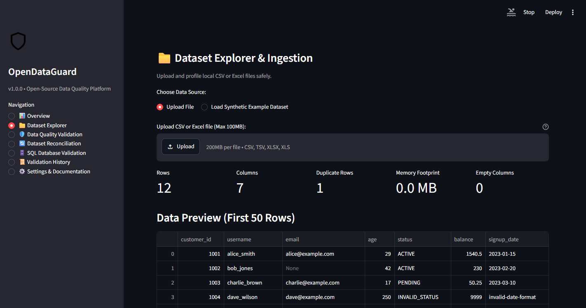
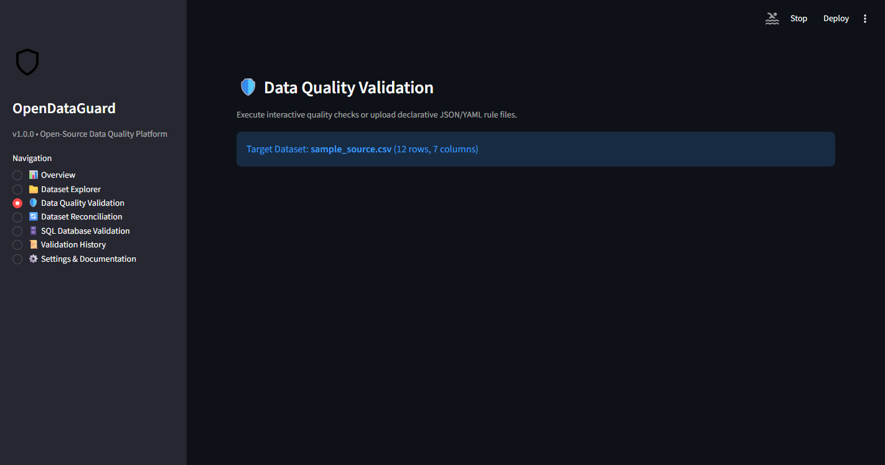
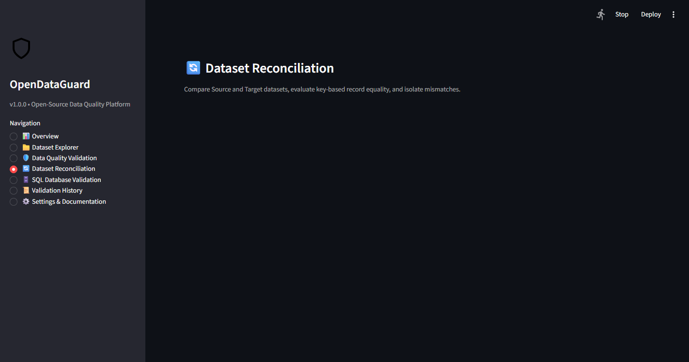
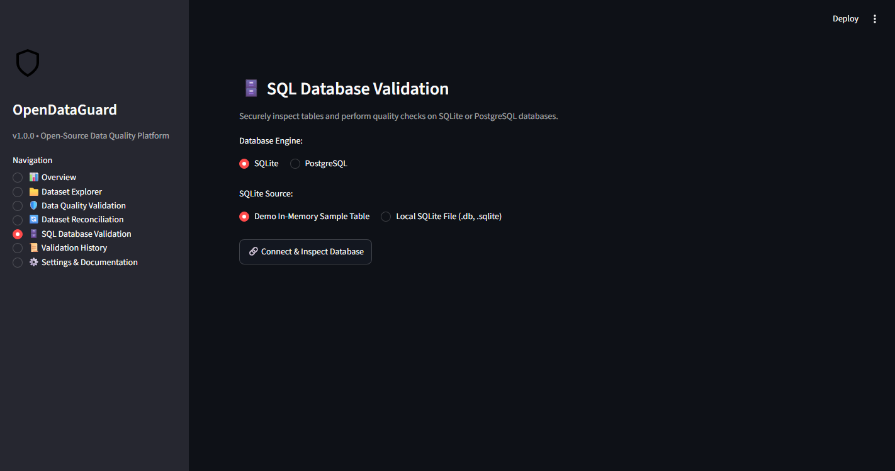
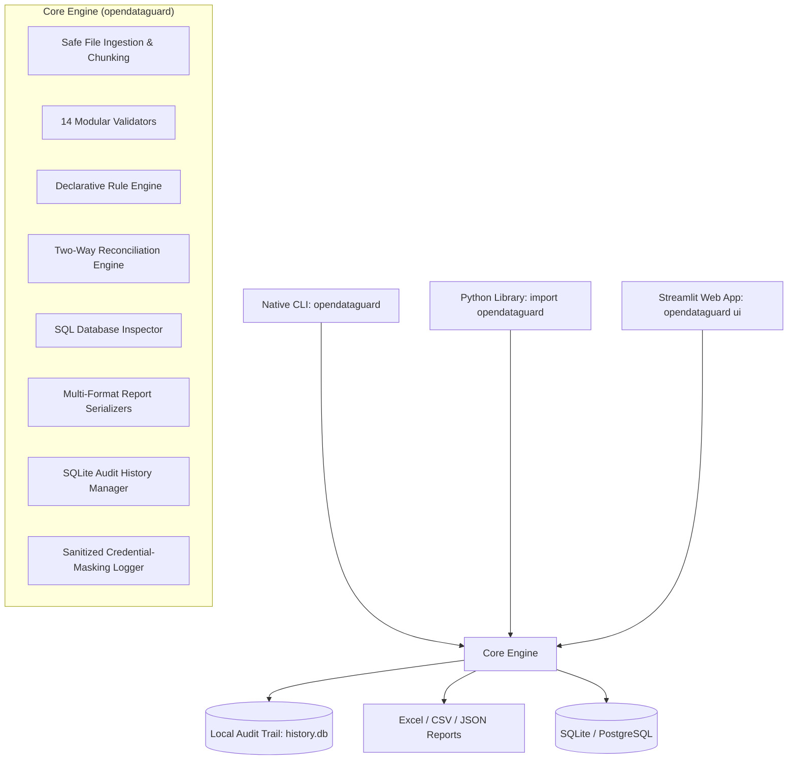

# OpenDataGuard 🛡️

**Open-Source Data Quality, Validation, and Reconciliation Platform**

[](https://pypi.org/project/opendataguard/)
[](https://pypi.org/project/opendataguard/)
[](https://github.com/RushikeshAlase7879/OpenDataGuard/actions)
[](LICENSE)
[](https://github.com/psf/black)

[PyPI Package](https://pypi.org/project/opendataguard/) • [GitHub Repository](https://github.com/RushikeshAlase7879/OpenDataGuard) • [Issue Tracker](https://github.com/RushikeshAlase7879/OpenDataGuard/issues) • [Documentation](docs/)

---

## 1. Overview

**OpenDataGuard** is a production-minded, open-source Python platform designed to help data analysts, analytics engineers, data engineers, and developers validate tabular datasets, assert data quality constraints, detect silent corruptions, perform rigorous dataset reconciliations, and inspect SQL database tables.

It is 100% open-source, local-first, and operates without vendor lock-in, proprietary cloud dependencies, telemetry, or paid APIs. OpenDataGuard provides three unified interfaces:

- **Native Command-Line Interface (CLI)**: Automate dataset validation, reconciliation, and reporting directly in bash/PowerShell scripts, Makefile targets, and CI/CD pipelines via `opendataguard`.
- **Embeddable Python Library**: Directly integrate modular data quality checks, reconciliation routines, and scoring into your Python scripts, pandas workflows, and automated ETL/ELT pipelines via `import opendataguard`.
- **Interactive Web Dashboard**: Explore dataset health visually, drill down into defect samples, perform side-by-side reconciliation, and export multi-sheet audit reports using the built-in Streamlit interface (`opendataguard ui`).

---

## 2. Problem Statement

Modern data pipelines frequently suffer from:

- **Silent data regressions**: Upstream schema modifications, null spikes, and unannounced type changes that silently corrupt downstream models and executive dashboards.
- **Flawed data migrations**: Cloud warehouse migrations and ETL transformations requiring tedious, error-prone manual spot-checking between source and target systems.
- **Cartesian explosion in reconciliation**: Naive join tools silently multiplying duplicate keys, generating millions of false diff records and crashing memory.
- **Heavyweight proprietary tooling**: Observability platforms that require expensive SaaS subscriptions, vendor lock-in, and security risks by transmitting company datasets over the wire.

OpenDataGuard solves these challenges with a 100% local, safe engine featuring deterministic scoring, transparent reporting, and zero network data transfer.

---

## 3. Key Features

- **🛡️ 15 Configurable Data Quality Checks**:
  1. **Missing values** with threshold tolerance (`check_missing_values`).
  2. **Duplicate row detection** across full rows or key subsets (`check_duplicate_rows`).
  3. **Unique key integrity** and null key enforcement (`check_key_uniqueness`).
  4. **Data type conformity** for integer, float, date, boolean, and text (`check_data_types`).
  5. **Date validity** and chronological range bounding (`check_date_validity`).
  6. **Numeric validity** with NaN and infinity guards (`check_numeric_validity`).
  7. **Numeric range boundaries** with min/max thresholds (`check_value_range`).
  8. **String length boundaries** with character count limits (`check_string_length`).
  9. **Categorical domain membership** with allowed value sets (`check_allowed_values`).
  10. **Regular expression pattern matching** (`check_regex_pattern`).
  11. **RFC-compliant email format validation** (`check_email_format`).
  12. **Schema and column mismatch detection** for missing/unexpected columns (`check_schema_mismatch`).
  13. **Outlier detection via Interquartile Range (IQR)** (`check_outliers_iqr`).
  14. **Row count boundary enforcement** (`check_row_count`).
  15. **Cross-column relational comparisons** (`check_column_comparison`) with conditional `when` triggers.

- **🔄 Two-Way Dataset Reconciliation**:
  - Key-based 1-to-1 diff between Source and Target datasets.
  - Cell-by-cell discrepancy tracking with configurable floating-point tolerances (`float_atol`, `float_rtol`).
  - Pre-flight duplicate key and null key guards to prevent accidental Cartesian explosion.
  - Clear isolation of *Source-Only*, *Target-Only*, *Value Mismatches*, and *Matched* records.
  - Native support for CSV, TSV, Excel, and Parquet (`.parquet`) formats.

- **📈 Continuous Data Quality Score (0.0% – 100.0%)**:
  - Deterministic composite scoring across all executed assertions:
    $$\text{DQ Score} = \left(\frac{1}{N} \sum_{i=1}^{N} \text{check\_score}_i\right) \times 100$$
  - Row-level checks: $\text{check\_score} = \max\left(0.0, 1.0 - \frac{\text{failed\_records}}{\text{total\_records}}\right)$.
  - Structural / schema checks: binary scoring ($1.0$ if passed, $0.0$ if failed).
  - Defaults safely to $100.0\%$ when no rules fail.

- **📜 Declarative Rules-as-Code & Table-Driven Dispatch**:
  - Author and version-control validation assertions in JSON or YAML.
  - Strict configuration schema validation rejecting malformed rules before execution.
  - Conditional assertions (`when: {column: "status", equals: "ACTIVE"}`).

- **🗄️ Multi-Schema SQL Database Auditing**:
  - Read-only schema and table auditing via SQLAlchemy 2.0 (SQLite included, PostgreSQL optional).
  - Schema-aware reflection (`schema="analytics"`) supporting enterprise multi-tenant databases.
  - Sensitive connection secrets and credentials are automatically masked in all logs and outputs.
  - Bounded queries prevent accidental memory exhaustion on large database tables.

- **📊 Interactive Streamlit Dashboard**:
  - Visual summary KPI cards and continuous Data Quality Scores.
  - Plotly-powered column error distributions and historical score trends.
  - Drill-down tables with failing row samples for immediate root-cause analysis.

- **📥 Memory-Bounded Multi-Format Reports**:
  - One-click export to multi-sheet Excel workbooks (`.xlsx`), streaming CSV, and deterministic JSON schemas.
  - Configurable row caps on discrepancy sheets to prevent out-of-memory errors on large datasets.

- **🔒 Local Audit History**:
  - Embedded SQLite audit ledger tracking validation and reconciliation execution metadata without persisting raw dataset rows.

---

## 4. Visual Preview

| Dataset Profiling & Overview | Quality Validation & Drill-down |
| :---: | :---: |
|  |  |

| Two-Way Reconciliation | SQL Database Inspector |
| :---: | :---: |
|  |  |

> 📸 **Full Showcase Gallery**: High-resolution captures for all views are available in the [Screenshots Gallery](docs/screenshots/README.md).

---

## 5. Architecture



---

## 6. Installation

OpenDataGuard supports Python **3.9, 3.10, 3.11, and 3.12** (verified across Ubuntu and Windows in continuous integration).

### Option A: Install from PyPI (Recommended for CLI & Pipelines)

Install the core package directly from PyPI into your virtual environment:

```bash
pip install opendataguard
```

This installs the Python library and registers the native `opendataguard` CLI binary in your environment's PATH.

If you plan to inspect PostgreSQL databases, install the optional PostgreSQL driver extra:

```bash
pip install "opendataguard[postgres]"
```

### Option B: Clone from GitHub (For Development & Web UI)

To run the interactive Streamlit dashboard or contribute to development:

```bash
# 1. Clone the repository
git clone https://github.com/RushikeshAlase7879/OpenDataGuard.git
cd OpenDataGuard

# 2. Create and activate a virtual environment
# Windows (PowerShell):
python -m venv venv
.\venv\Scripts\Activate.ps1

# Linux / macOS:
python3 -m venv venv
source venv/bin/activate

# 3. Install dependencies in editable mode
pip install --upgrade pip
pip install -r requirements.txt
pip install -e .

# Optional: Install development & testing tools
pip install -e ".[dev]"
```

---

## 7. Quickstart Guide

### 7.1 Native Command-Line Interface (CLI)

The `opendataguard` CLI provides instant, zero-boilerplate validation and reconciliation for terminal scripts, Makefile workflows, and automated CI/CD pipelines.

#### 1. Display Help & Version
```bash
opendataguard --help
opendataguard --version
opendataguard version
```

#### 2. Validate a Dataset against Rules
Run automated data quality assertions against CSV or Excel datasets using declarative JSON or YAML rules:
```bash
# Basic validation with stdout quality scorecard
opendataguard validate --data examples/sample_source.csv --rules config/sample_rules.yaml

# Save a deterministic JSON audit report and enforce a minimum score threshold
opendataguard validate --data examples/sample_source.csv --rules config/sample_rules.yaml --output report.json --min-score 90.0

# Export multi-tab Excel workbook or CSV report
opendataguard validate --data data.csv --rules rules.yaml --output validation_report.xlsx
opendataguard validate --data data.csv --rules rules.yaml --output validation_report.csv
```

#### 3. Reconcile Two Datasets
Compare source and target datasets row-by-row on key columns with automatic numeric tolerance:
```bash
# Single primary key reconciliation
opendataguard reconcile --source examples/sample_source_deduped.csv --target examples/sample_target.csv --keys customer_id

# Composite keys with multi-tab Excel mismatch export
opendataguard reconcile --source source.csv --target target.csv --keys region store_id --output rec_report.xlsx

# Comma-separated keys with JSON summary output
opendataguard reconcile --source source.csv --target target.csv --keys "country,store_id" --output rec_summary.json
```

#### 4. Launch the Interactive Web Dashboard
```bash
# Launch Streamlit web UI (opens at http://localhost:8501)
opendataguard ui

# Run in headless mode on a custom port
opendataguard ui --port 8501 --no-browser
```

#### 5. CLI Exit Codes & CI/CD Contracts
OpenDataGuard uses standard POSIX exit codes designed for automated pipelines and error monitoring:

| Exit Code | Meaning | Condition |
| :---: | :--- | :--- |
| **`0`** | **Success** | All validation rules passed and score $\ge$ `--min-score`, or datasets are 100% matched without discrepancies. |
| **`1`** | **Quality Discrepancy** | One or more validation checks failed, quality score is below `--min-score`, or dataset reconciliation found mismatches / key warnings. |
| **`2`** | **Runtime / System Error** | Invalid CLI arguments, missing input files, malformed JSON/YAML syntax, or unsupported configuration. |

---

### 7.2 In-Memory DataFrame Validation (Python API)

```python
import pandas as pd
from opendataguard import (
    check_missing_values,
    check_value_range,
    check_email_format,
    check_outliers_iqr,
    check_row_count,
    calculate_data_quality_score,
)

# Sample dataset
df = pd.DataFrame({
    "customer_id": [1001, 1002, 1003],
    "email": ["alice@example.com", "bob@example.com", None],
    "age": [25, 42, 19],
    "balance": [100.50, 250.00, 310.25],
})

# Run individual quality checks
res_missing = check_missing_values(df, column="email")
res_age = check_value_range(df, column="age", min_value=18, max_value=120)
res_email = check_email_format(df, column="email")
res_outliers = check_outliers_iqr(df, column="balance", factor=1.5)
res_rows = check_row_count(df, min_rows=1, max_rows=100000)

# Compute composite Data Quality Score (0.0% to 100.0%)
all_checks = [res_missing, res_age, res_email, res_outliers, res_rows]
score = calculate_data_quality_score(all_checks)

print(f"Data Quality Score: {score:.2f}%")
print(f"Email check passed: {res_missing.passed} (Failed rows: {res_missing.failed_records})")
```

### 7.3 Declarative Rule Suite Execution (Python API)

Execute validation suites defined in JSON or YAML:

```python
import pandas as pd
from opendataguard import load_rules, execute_rule_suite

df = pd.read_csv("examples/sample_source.csv")

# Load and execute rule suite from JSON or YAML
rules = load_rules("config/sample_rules.json")
suite_results = execute_rule_suite(df, rules)

passed_count = sum(1 for r in suite_results if r.passed)
print(f"Executed {len(suite_results)} rules: {passed_count} passed.")
```

### 7.4 Two-Way Dataset Reconciliation (Python API)

Compare two tabular datasets with key alignment, tolerance handling, and discrepancy categorization:

```python
import pandas as pd
from opendataguard import reconcile_datasets

source_df = pd.read_csv("examples/sample_source_deduped.csv")
target_df = pd.read_csv("examples/sample_target.csv")

# Reconcile on customer_id with numeric tolerance
rec = reconcile_datasets(
    source_df,
    target_df,
    key_columns="customer_id",
    float_atol=1e-4,
    float_rtol=1e-4,
)

print(f"Match Rate: {rec.summary.match_rate_percent}%")
print(f"Matched Records: {rec.summary.matched_records}")
print(f"Mismatched Records: {rec.summary.mismatched_records}")
print(f"Source-Only Records: {rec.summary.source_only_records}")
print(f"Target-Only Records: {rec.summary.target_only_records}")

# Inspect cell-level mismatches
if not rec.mismatched_df.empty:
    print(rec.mismatched_df.head())
```

### 7.5 Generating Audit Reports (Python API)

Export standardized reports in JSON, CSV, or multi-sheet Excel:

```python
from opendataguard import (
    generate_validation_json,
    generate_validation_csv,
    generate_validation_excel,
)

# Export validation suite results
json_report = generate_validation_json(suite_results, dataset_name="customers")
csv_report = generate_validation_csv(suite_results, dataset_name="customers")
excel_bytes = generate_validation_excel(suite_results, dataset_name="customers")

with open("validation_report.json", "w", encoding="utf-8") as f:
    f.write(json_report)
```

### 7.6 Launching the Web Dashboard

OpenDataGuard provides two straightforward ways to launch the interactive dashboard:

```bash
# Recommended for all installations (PyPI package or development checkout):
opendataguard ui

# Alternatively, from a cloned repository root:
streamlit run app.py
```

Then open your browser at `http://localhost:8501`. For a guided UI walkthrough, consult [docs/DEMO_GUIDE.md](docs/DEMO_GUIDE.md). For complete CLI syntax, see [docs/cli_reference.md](docs/cli_reference.md).

---

## 8. Declarative Rules-as-Code Configuration

Rules can be version-controlled in JSON or YAML.

### JSON Specification (`config/sample_rules.json`)

```json
{
  "version": "1.0",
  "description": "Validation Rules for Customer Records",
  "rules": [
    { "rule": "required", "column": "customer_id", "threshold_percent": 0.0 },
    { "rule": "required", "column": "email", "threshold_percent": 0.0 },
    { "rule": "unique", "columns": ["customer_id"] },
    { "rule": "duplicate_rows" },
    { "rule": "range", "column": "age", "min": 18, "max": 120 },
    { "rule": "allowed_values", "column": "status", "values": ["ACTIVE", "INACTIVE", "PENDING"] },
    { "rule": "email", "column": "email" },
    { "rule": "regex", "column": "username", "pattern": "^[a-zA-Z0-9_]{3,30}$" },
    { "rule": "date_format", "column": "signup_date", "format": "%Y-%m-%d" },
    {
      "rule": "schema",
      "expected_columns": ["customer_id", "username", "email", "age", "status", "balance", "signup_date"],
      "strict": false
    }
  ]
}
```

### YAML Specification (`config/sample_rules.yaml`)

```yaml
version: "1.0"
description: "Validation Rules for Customer Records"
rules:
  - rule: required
    column: customer_id
    threshold_percent: 0.0

  - rule: required
    column: email
    threshold_percent: 0.0

  - rule: unique
    columns:
      - customer_id

  - rule: duplicate_rows

  - rule: range
    column: age
    min: 18
    max: 120

  - rule: allowed_values
    column: status
    values:
      - ACTIVE
      - INACTIVE
      - PENDING

  - rule: email
    column: email

  - rule: regex
    column: username
    pattern: "^[a-zA-Z0-9_]{3,30}$"

  - rule: date_format
    column: signup_date
    format: "%Y-%m-%d"

  - rule: schema
    expected_columns:
      - customer_id
      - username
      - email
      - age
      - status
      - balance
      - signup_date
    strict: false
```

---

## 9. Supported Formats & Database Engines

- **Supported File Formats**:
  - **CSV** (`.csv`): Ingested with automatic encoding fallback (`utf-8`, `utf-8-sig`, `latin1`, `cp1252`, `iso-8859-1`).
  - **TSV / Delimited Text** (`.tsv`, `.txt`): Tab- and comma-delimited text files.
  - **Excel** (`.xlsx`, `.xls`): Parsed securely via OpenPyXL without macro or script execution.
  - **Chunked CSV Reading**: Bounded memory stream via `read_csv_in_chunks` for high-volume tabular files.

- **Database Inspection**:
  - **SQLite**: Out-of-the-box support for both file-based databases (`sqlite:///path/to/db.sqlite`) and in-memory test databases (`sqlite:///:memory:`).
  - **PostgreSQL**: Architecturally supported via SQLAlchemy connection strings (`postgresql+psycopg2://...`), requiring the optional `psycopg2-binary` driver (`pip install "opendataguard[postgres]"`).
    > **Note**: PostgreSQL connection handling and fallback error logic are tested via unit mocks and driver validation. Live server testing requires a running PostgreSQL instance.

---

## 10. Technology Stack & Dependencies

OpenDataGuard relies on the following verified core dependencies:

| Component | Technology | Version Constraint |
| :--- | :--- | :--- |
| **Python** | Runtime | `>=3.9` (Verified on 3.9, 3.10, 3.11, 3.12 across Ubuntu & Windows in CI) |
| **Data Processing** | `pandas` | `>=2.2.0, <3.0.0` |
| **Numeric Computations** | `numpy` | `>=1.26.0, <3.0.0` |
| **Interactive Dashboard** | `streamlit` | `>=1.35.0, <2.0.0` |
| **Database Reflection** | `SQLAlchemy` | `>=2.0.0, <3.0.0` |
| **Spreadsheet Generation**| `openpyxl` | `>=3.1.2, <4.0.0` |
| **Visualizations** | `plotly` | `>=5.20.0, <8.0.0` |
| **Configuration Parsing** | `PyYAML` | `>=6.0.1, <7.0.0` |
| **Data Validation** | `pydantic` | `>=2.7.0, <3.0.0` |
| **PostgreSQL (Optional)**| `psycopg2-binary`| `>=2.9.9` |

---

## 11. Security and Privacy Safeguards

- **100% Local In-Memory Execution**: Uploaded datasets are processed strictly in memory during your active session; data is never transmitted to external cloud services or telemetry endpoints.
- **Strict Read-Only Database Auditing**: SQL inspections execute safe schema discovery (`inspect()`) and bounded `SELECT` queries. Destructive statements (`DROP`, `ALTER`, `TRUNCATE`, `DELETE`, `UPDATE`, `INSERT`) are strictly blocked before submission.
- **Automated Credential Masking**: Passwords and secret connection strings in database URIs are automatically redacted (`***`) by `SanitizingFilter` across all application logs and UI views.
- **Untrusted File Hardening**: File sizes are capped by default (100 MB threshold, configurable via environment variable), and unsupported extensions are rejected before ingestion.
- **Privacy-First Audit Trail**: Local SQLite audit history records execution timestamps, rule pass/fail counts, and composite scores without storing raw customer data rows. Note that while this audit history persists across application restarts, it is user-clearable and not cryptographically immutable.

---

## 12. Configuration & Environment Variables

OpenDataGuard operates with sensible zero-configuration defaults, but can be customized using environment variables or a `.env` file (see [`.env.example`](.env.example)):

| Variable | Default Value | Description |
| :--- | :--- | :--- |
| `OPENDATAGUARD_MAX_UPLOAD_BYTES` | `104857600` (100 MB) | Maximum dataset file upload size in bytes to protect against memory exhaustion. |
| `OPENDATAGUARD_HISTORY_DB` | `~/.opendataguard/history.db` | Custom local file path for SQLite audit ledger storage. |

---

## 13. Known Limitations

- **In-Memory DataFrame Scale**: Datasets larger than physical RAM (> 1–2 GB) may encounter memory limits if loaded in full. For large CSV files, use the provided streaming reader (`read_csv_in_chunks`).
- **Composite Key Type Conversions**: Mixed-type composite reconciliation keys (e.g., matching integer `1` with string `"1"`) require explicit type casting prior to diffing to avoid false key mismatches.
- **Nested Semi-Structured Payloads**: Hierarchical JSON or nested dictionary payloads inside individual column cells should be flattened into tabular columns before running column-specific assertions.

---

## 14. Project Structure

```
OpenDataGuard/
├── app.py                      # Interactive Streamlit Web Platform
├── README.md                   # Project Overview and Documentation
├── LICENSE                     # MIT Open Source License
├── CONTRIBUTING.md             # Contribution Guidelines
├── CODE_OF_CONDUCT.md          # Community Code of Conduct
├── SECURITY.md                 # Security & Vulnerability Disclosure Policy
├── CHANGELOG.md                # Version History
├── requirements.txt            # Pinned dependencies
├── pyproject.toml              # Build & package configuration
├── .gitignore                  # Git ignore rules
├── .env.example                # Sample environment variables
├── .github/
│   └── workflows/
│       └── tests.yml           # Automated Multi-OS CI/CD Pipeline
├── config/
│   ├── sample_rules.json       # Example declarative validation rules (JSON)
│   └── sample_rules.yaml       # Example declarative validation rules (YAML)
├── docs/
│   ├── architecture.md         # Architecture & module breakdown
│   ├── installation.md         # Detailed setup instructions
│   ├── validation_rules.md     # Declarative rule specification guide
│   ├── troubleshooting.md      # FAQ and problem resolution
│   ├── cli_reference.md        # Command-line interface reference manual
│   ├── DEMO_GUIDE.md           # Step-by-step demonstration walkthrough
│   └── screenshots/            # Showcase screenshots & capture guide
├── src/
│   └── opendataguard/
│       ├── __init__.py         # Public API exports
│       ├── cli.py              # Native command-line interface entrypoint
│       ├── validators.py       # 14 Core data quality checks & safe ingestion
│       ├── reconciliation.py   # Two-way dataset diffing engine
│       ├── database.py         # SQLAlchemy 2.0 read-only database auditor
│       ├── rules.py            # JSON/YAML rule parser & execution engine
│       ├── reports.py          # Excel, CSV, and JSON report generator
│       ├── history.py          # SQLite local audit trail manager
│       └── logging_config.py   # Secure credential-masking logger
├── tests/
│   ├── __init__.py
│   ├── test_cli.py             # CLI command & exit code tests
│   ├── test_database.py        # Database inspection tests
│   ├── test_e2e_features.py    # End-to-end integration tests
│   ├── test_history.py         # History manager tests
│   ├── test_reconciliation.py  # Reconciliation engine tests
│   ├── test_reports.py         # Report generation tests
│   ├── test_rules.py           # Declarative rule engine tests
│   ├── test_ui_app.py          # Streamlit UI page & rendering tests
│   └── test_validators.py      # Validator & ingestion unit tests
├── examples/
│   ├── sample_source.csv       # Synthetic source with intentional defects
│   ├── sample_source_deduped.csv # Cleaned source for reconciliation
│   ├── sample_target.csv       # Synthetic target with mismatches
│   └── README.md               # Dataset documentation
└── scripts/
    └── run_tests.py            # Automated test runner script
```

---

## 15. Automated Testing

OpenDataGuard features an automated test suite comprising 115 unit, CLI, integration, and UI tests:

```bash
# Run the test suite via the standalone test runner:
python scripts/run_tests.py

# Or directly with pytest:
pytest tests/ -v
```

---

## 16. Contributing

Contributions are welcome! Whether reporting a bug, improving documentation, or submitting a pull request, please review:

1. [CONTRIBUTING.md](CONTRIBUTING.md) for local development setup, coding standards, and PR workflows.
2. [CODE_OF_CONDUCT.md](CODE_OF_CONDUCT.md) for community guidelines.

To report security vulnerabilities, please refer to our [SECURITY.md](SECURITY.md) policy.

---

## 17. License

OpenDataGuard is distributed under the **MIT License**. See [LICENSE](LICENSE) for details.
