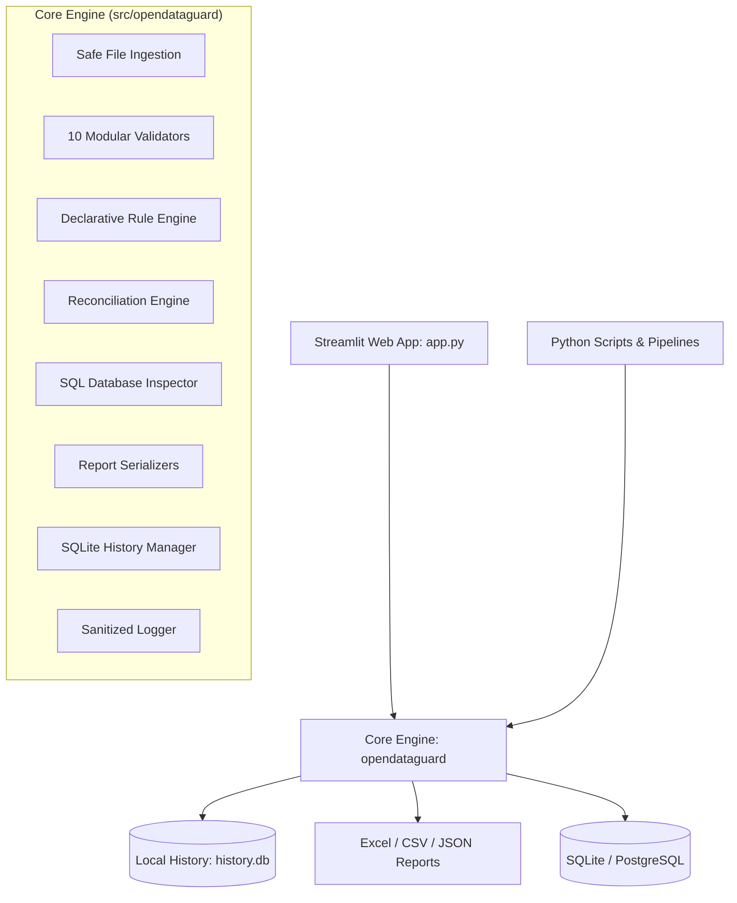

# OpenDataGuard 🛡️

**Open-Source Data Quality, Validation, and Reconciliation Platform**

[](https://github.com/RushikeshAlase7879/OpenDataGuard/actions)
[](https://www.python.org/)
[](LICENSE)
[](https://github.com/psf/black)

---

## 1. Overview

**OpenDataGuard** is a production-minded, open-source Python platform designed to help data analysts, analytics engineers, data engineers, and developers validate tabular datasets, assert data quality constraints, detect silent corruptions, perform rigorous dataset reconciliations, and inspect SQL database tables without vendor lock-in, proprietary cloud dependencies, or paid APIs.

Whether running in an automated ETL CI/CD pipeline or as an interactive local web app, OpenDataGuard gives teams full visibility and confidence into their data.

---

## 2. Problem Statement

Modern data pipelines frequently suffer from:
- **Silent data regressions**: Upstream schema modifications, null spikes, or unannounced type changes breaking downstream dashboards.
- **Flawed data migrations**: Cloud migrations and ETL transformations requiring tedious manual spot-checking between source and target systems.
- **Cartesian explosion in reconciliation**: Naive join tools silently multiplying duplicate keys, generating false diff results.
- **Heavyweight proprietary tooling**: Existing data observability platforms that require expensive enterprise contracts, external SaaS credentials, or security risks by transmitting company datasets over the wire.

OpenDataGuard solves these problems with a 100% local, safe, open-source engine with deterministic scoring, transparent reporting, and zero telemetry.

---

## 3. Key Features

- **🛡️ 12 Configurable Data Quality Checks**:
  1. Missing / null value detection with threshold tolerance (`check_missing_values`).
  2. Full row and subset duplicate detection (`check_duplicate_rows`).
  3. Unique key and null key integrity enforcement (`check_key_uniqueness`).
  4. Data type conformity: integer, float, date, boolean, text (`check_data_types`).
  5. Date validity and chronological range bounding (`check_date_validity`).
  6. Numeric validity with NaN and infinity guards (`check_numeric_validity`).
  7. Min/max numeric range limits (`check_value_range`).
  8. String length boundaries: min/max character count (`check_string_length`).
  9. Categorical domain membership: allowed values (`check_allowed_values`).
  10. Schema and column mismatch detection: missing/unexpected columns (`check_schema_mismatch`).
  11. Regular expression pattern matching (`check_regex_pattern`).
  12. Email format validation (`check_email_format`).

- **📁 Supported File Formats**:
  - **CSV** (`.csv`): Supported with automatic encoding fallback (`utf-8`, `utf-8-sig`, `latin1`, `cp1252`, `iso-8859-1`).
  - **TSV / Delimited Text** (`.tsv`, `.txt`): Tab- and comma-delimited text files.
  - **Excel** (`.xlsx`, `.xls`): Parsed safely via OpenPyXL without executing macros or scripts.
  - **Chunked CSV Reading**: Bounded memory stream via `read_csv_in_chunks` for large files.

- **📈 Continuous Data Quality Score (0.0% – 100.0%)**:
  - Deterministic scoring computed across all executed assertions:
    $$\text{DQ Score} = \left(\frac{1}{N} \sum_{i=1}^{N} \text{check\_score}_i\right) \times 100$$
  - Row-level checks: $\text{check\_score} = \max\left(0.0, 1.0 - \frac{\text{failed\_records}}{\text{total\_records}}\right)$.
  - Structural / schema checks: binary scoring ($1.0$ if passed, $0.0$ if failed).
  - Defaults safely to $100.0\%$ if no rules are specified.

- **🔄 Two-Way Dataset Reconciliation**:
  - Key-based 1-to-1 diff between Source and Target datasets.
  - Cell-by-cell discrepancy tracking.
  - Floating-point tolerance (`atol` and `rtol`) for precision differences.
  - Duplicate key and null key guards to prevent accidental Cartesian explosion.
  - Clear isolation of *Source-Only*, *Target-Only*, *Value Mismatches*, and *Matched* records.

- **📜 Declarative Rules-as-Code**:
  - Author and version-control validation assertions in JSON or YAML.
  - Strict config validation rejecting malformed rules before execution.

- **🗄️ Secure SQL Database Auditing**:
  - Read-only schema and table auditing via SQLAlchemy 2.0 (SQLite default, PostgreSQL optional).
  - Passwords and connection secrets are automatically masked in logs and output.
  - Bounded queries prevent accidental memory exhaustion on large database tables.

- **📊 Interactive Streamlit Dashboard**:
  - Visual summary cards and continuous Data Quality Scores ($0\% - 100\%$).
  - Plotly-powered column error distributions and historical score trends.
  - Drill-down tables with failing row samples.

- **📥 Multi-Format Deterministic Reports**:
  - One-click export to multi-sheet Excel workbooks (`.xlsx`), CSV, and deterministic JSON schemas with UTC ISO-8601 timestamps.

- **🔒 Local Audit History**:
  - Embedded SQLite audit ledger tracking execution metadata without persisting raw source data rows.

---

## 4. Architecture



---

## 5. Technology Stack

- **Python**: 3.10, 3.11, 3.12
- **Data Processing**: Pandas, NumPy
- **Interactive UI**: Streamlit
- **Visualizations**: Plotly
- **Database Layer**: SQLAlchemy 2.0, SQLite (default), optional psycopg2 for PostgreSQL
- **Spreadsheet Generation**: OpenPyXL
- **Rules Serialization**: PyYAML, json
- **Test Framework**: Pytest
- **CI/CD**: GitHub Actions

---

## 6. Installation & Prerequisites

### Prerequisites
- Python 3.10+ installed.
- Git.

### Step 1: Clone Repository
```bash
git clone https://github.com/RushikeshAlase7879/OpenDataGuard.git
cd OpenDataGuard
```

### Step 2: Set Up Virtual Environment

**Windows (PowerShell):**
```powershell
python -m venv venv
.\venv\Scripts\Activate.ps1
```

**macOS / Linux:**
```bash
python3 -m venv venv
source venv/bin/activate
```

### Step 3: Install Dependencies
```bash
pip install --upgrade pip
pip install -r requirements.txt
pip install -e .

# Optional: Install PostgreSQL support driver
pip install -e .[postgres]  # Or: pip install psycopg2-binary
```

---

## 7. Quickstart & Application Startup

To launch the interactive Streamlit dashboard:
```bash
streamlit run app.py
```
Open your browser at `http://localhost:8501`.

---

## 8. Automated Testing

Run the comprehensive automated test suite (79 unit, integration, and UI tests covering all modules):

```bash
# Using the test runner script:
python scripts/run_tests.py

# Or directly with pytest:
pytest tests/ -v
```

---

## 9. Python API Usage

OpenDataGuard can be embedded directly in your Python ETL pipelines:

```python
import pandas as pd
from opendataguard.validators import check_missing_values, check_value_range, calculate_data_quality_score
from opendataguard.reconciliation import reconcile_datasets
from opendataguard.rules import load_rules, execute_rule_suite

# 1. Direct Validation
df = pd.read_csv("examples/sample_source.csv")
res1 = check_missing_values(df, column="email")
res2 = check_value_range(df, column="age", min_value=18, max_value=120)

score = calculate_data_quality_score([res1, res2])
print(f"Data Quality Score: {score}%")

# 2. Rule Suite Execution
rules = load_rules("config/sample_rules.json")
suite_results = execute_rule_suite(df, rules)

# 3. Two-Way Dataset Reconciliation
source = pd.read_csv("examples/sample_source_deduped.csv")
target = pd.read_csv("examples/sample_target.csv")
rec = reconcile_datasets(source, target, key_columns="customer_id", float_atol=1e-4)

print(f"Match Rate: {rec.summary.match_rate_percent}%")
print(f"Mismatches: {rec.summary.mismatched_records}")
```

---

## 10. Example Validation Rules (JSON & YAML)

Validation suites can be authored as declarative JSON or YAML files and checked into version control:

### JSON Configuration (`config/sample_rules.json`)
```json
{
  "version": "1.0",
  "description": "Validation Rules for Customer Records",
  "rules": [
    { "rule": "required", "column": "customer_id", "threshold_percent": 0.0 },
    { "rule": "required", "column": "email", "threshold_percent": 0.0 },
    { "rule": "unique", "columns": ["customer_id"] },
    { "rule": "duplicate_rows" },
    { "rule": "range", "column": "age", "min": 18, "max": 120 },
    { "rule": "allowed_values", "column": "status", "values": ["ACTIVE", "INACTIVE", "PENDING"] },
    { "rule": "email", "column": "email" },
    { "rule": "regex", "column": "username", "pattern": "^[a-zA-Z0-9_]{3,30}$" },
    { "rule": "date_format", "column": "signup_date", "format": "%Y-%m-%d" },
    {
      "rule": "schema",
      "expected_columns": ["customer_id", "username", "email", "age", "status", "balance", "signup_date"],
      "strict": false
    }
  ]
}
```

### YAML Configuration (`config/sample_rules.yaml`)
```yaml
version: "1.0"
description: "Validation Rules for Customer Records"
rules:
  - rule: required
    column: customer_id
    threshold_percent: 0.0

  - rule: required
    column: email
    threshold_percent: 0.0

  - rule: unique
    columns:
      - customer_id

  - rule: duplicate_rows

  - rule: range
    column: age
    min: 18
    max: 120

  - rule: allowed_values
    column: status
    values:
      - ACTIVE
      - INACTIVE
      - PENDING

  - rule: email
    column: email

  - rule: regex
    column: username
    pattern: "^[a-zA-Z0-9_]{3,30}$"

  - rule: date_format
    column: signup_date
    format: "%Y-%m-%d"

  - rule: schema
    expected_columns:
      - customer_id
      - username
      - email
      - age
      - status
      - balance
      - signup_date
    strict: false
```

---

## 11. Sample Datasets Walkthrough

Synthetic datasets are pre-packaged in `examples/`:
- `sample_source.csv`: Contains intentional edge cases (duplicate customer ID 1001, null email, out-of-bounds age 250, invalid date format, invalid categorical status).
- `sample_source_deduped.csv`: Deduplicated version ready for 1-to-1 reconciliation.
- `sample_target.csv`: Downstream target dataset containing target-only customer 1099, value mismatches on customer 1005 (status changed to SUSPENDED, balance changed), and floating-point tolerance test on customer 1007.

See [examples/README.md](examples/README.md) for full descriptions.

---

## 12. Security and Privacy Safeguards

- **100% Local In-Memory Execution**: Uploaded datasets are held only in local memory during your active session; data is never transmitted to external cloud services or telemetry endpoints.
- **Strict Read-Only Database Auditing**: SQL inspections run exclusively safe schema discovery (`inspect()`) and bounded `SELECT` queries. Destructive statements (`DROP`, `ALTER`, `TRUNCATE`, `DELETE`, `UPDATE`, `INSERT`) are prohibited and blocked before submission.
- **Systematic Credential Masking**: Passwords and secret connection strings in database URIs are automatically redacted (`***`) by `SanitizingFilter` across all application logs and UI views.
- **Untrusted File Hardening**: File sizes are capped by default (100MB threshold), and unsupported extensions are rejected before ingestion. Excel files are parsed securely via OpenPyXL without VBA macro or external script execution.
- **Persistent Local Audit History (Non-Immutable)**: Historical run metrics (rule counts, score, execution timestamps) are recorded locally in SQLite (`~/.opendataguard/history.db`). Raw data rows are never stored in history. Note that while this audit history persists across application and server restarts, it is user-clearable and not cryptographically immutable.

---

## 13. Database Support & Limitations

- **SQLite**: Fully supported and verified out-of-the-box for both file-based databases (`sqlite:///path/to/db.sqlite`) and in-memory test databases (`sqlite:///:memory:`).
- **PostgreSQL**: Architecturally supported via SQLAlchemy connection strings (`postgresql+psycopg2://...`), but requires installing the optional `psycopg2-binary` driver (`pip install -e .[postgres]`).
  > **Verification Status**: PostgreSQL connection handling and fallback error logic have been tested via mocks and driver checks. However, **PostgreSQL has NOT been tested against an active live PostgreSQL server** in this verification environment because no live server instance was provisioned.
- **Schema & Table Restrictions**: Only existing tables/views can be sampled. Multi-table relational joins and custom SQL execution queries are restricted to preserve database safety and prevent unintended I/O load.

---

## 14. Known Limitations & Issues

- **Memory Ceiling for Monolithic DataFrames**: Like standard pandas workloads, large datasets (> 1-2 GB) may encounter memory limits if loaded in full. For high-volume CSV files, use the provided chunked reader utility (`read_csv_in_chunks`).
- **Composite Key Type Conversions**: Mixed-type composite reconciliation keys (e.g., matching integer `1` with string `"1"`) require explicit type casting before diffing to avoid false key mismatches.
- **Nested / Semi-Structured Objects**: Hierarchical JSON or dictionary payloads inside individual column cells must be flattened into tabular columns before running column-specific assertions.

---

## 15. Project Structure

```
OpenDataGuard/
├── app.py                      # Interactive Streamlit Web Platform
├── README.md                   # Project Overview and Documentation
├── LICENSE                     # MIT Open Source License
├── CONTRIBUTING.md             # Contribution Guidelines
├── CODE_OF_CONDUCT.md          # Community Code of Conduct
├── SECURITY.md                 # Security & Vulnerability Disclosure Policy
├── CHANGELOG.md                # Version History
├── requirements.txt            # Pinned dependencies
├── pyproject.toml              # Build & package configuration
├── .gitignore                  # Git ignore rules
├── .env.example                # Sample environment variables
├── .github/
│   └── workflows/
│       └── tests.yml           # Multi-OS Automated CI/CD
├── config/
│   ├── sample_rules.json       # Example declarative validation rules (JSON)
│   └── sample_rules.yaml       # Example declarative validation rules (YAML)
├── docs/
│   ├── architecture.md         # Architecture & module breakdown
│   ├── installation.md         # Detailed setup instructions
│   ├── validation_rules.md     # Declarative rule specification guide
│   └── troubleshooting.md      # FAQ and problem resolution
├── src/
│   └── opendataguard/
│       ├── __init__.py         # Public API exports
│       ├── validators.py       # Core data quality checks & safe ingestion
│       ├── reconciliation.py   # Two-way dataset diffing engine
│       ├── database.py         # SQLAlchemy 2.0 read-only database auditor
│       ├── rules.py            # JSON/YAML rule parser & execution engine
│       ├── reports.py          # Excel, CSV, and JSON report generator
│       ├── history.py          # SQLite local audit trail manager
│       └── logging_config.py   # Secure credential-masking logger
├── tests/
│   ├── __init__.py
│   ├── test_database.py        # Database inspection tests
│   ├── test_e2e_features.py    # End-to-end integration tests
│   ├── test_history.py         # History manager tests
│   ├── test_reconciliation.py  # Reconciliation engine tests
│   ├── test_reports.py         # Report generation tests
│   ├── test_rules.py           # Declarative rule engine tests
│   └── test_validators.py      # Validator & ingestion unit tests
├── examples/
│   ├── sample_source.csv       # Synthetic source with intentional defects
│   ├── sample_source_deduped.csv # Cleaned source for reconciliation
│   ├── sample_target.csv       # Synthetic target with mismatches
│   └── README.md               # Dataset documentation
└── scripts/
    └── run_tests.py            # Standalone test runner script
```

---

## 16. License

Distributed under the **MIT License**. See [LICENSE](LICENSE) for details.
