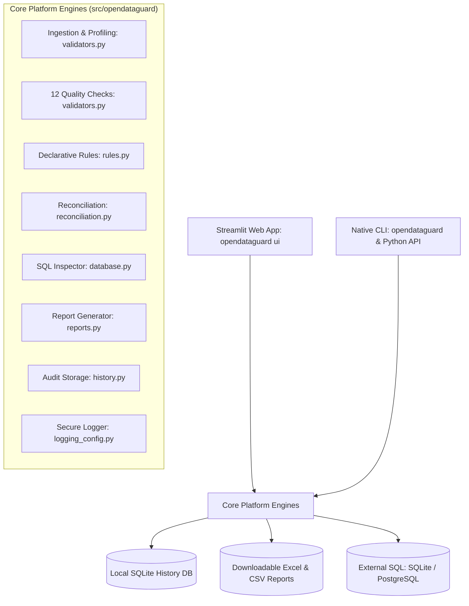

# OpenDataGuard Architecture

This document describes the high-level architecture, module decomposition, and data flow of **OpenDataGuard**.

## 1. Architectural Overview

OpenDataGuard is structured with a decoupled layered architecture that cleanly separates the core validation and reconciliation logic from user interfaces and persistence layers.

---

## 2. Core Modules

### Ingestion & Profiling (`validators.py`)
- Responsible for safe file inspection (file size limits, extension verification, encoding fallbacks).
- Parses CSV, TSV, and Excel into in-memory pandas DataFrames.
- Computes structural metadata (row count, column count, memory footprint, null counts) without mutating source data.

### Validation Engine (`validators.py`)
- Implements 12 modular, stateless validation functions.
- Every function returns a standardized `ValidationResult` dataclass containing:
  - `check_name`, `column_name`, `total_records`, `failed_records`, `passed`, `message`, `failing_sample`, `details`.
- Computes a continuous, documented Data Quality Score:
  $$\text{Score} = \frac{1}{N} \sum_{i=1}^{N} \max\left(0, 1 - \frac{\text{failed\_records}_i}{\text{total\_records}_i}\right) \times 100$$

### Declarative Rules Engine (`rules.py`)
- Parses rule definitions serialized in JSON or YAML.
- Validates the rule configuration against strict parameter schemas, rejecting unknown rules with actionable errors.
- Maps declarative rules to core validation functions and produces batch evaluation results.

### Reconciliation Engine (`reconciliation.py`)
- Performs two-way comparisons between a Source and a Target dataset.
- Enforces key uniqueness prior to joining to prevent many-to-many Cartesian explosion.
- Evaluates cell-level differences with configurable absolute and relative float tolerances (`atol`, `rtol`).
- Isolates source-only records, target-only records, value mismatches, and identical records.

### SQL Database Auditing (`database.py`)
- Provides read-only database connectivity using SQLAlchemy 2.0.
- Masks connection secrets in logs and UI errors.
- Uses catalog reflection to inspect table definitions and fetch bounded samples for validation.

### Reports Engine (`reports.py`)
- Serializes validation and reconciliation results into multi-tab Excel workbooks (using `openpyxl`), CSV streams, and deterministic JSON schemas with UTC ISO-8601 timestamps.

### Command-Line Interface (`cli.py`)
- Provides native console script entry point `opendataguard` registered in `pyproject.toml`.
- Implements four production-grade subcommands (`validate`, `reconcile`, `ui`, `version`) built strictly on Python's standard library `argparse` without external dependencies.
- Enforces strict POSIX exit codes (`0`: clean pass, `1`: quality defect or reconciliation discrepancy, `2`: runtime/syntax error) for CI/CD automation.

### Audit History Manager (`history.py`)
- Manages an embedded SQLite database (`history.db`) storing execution metadata, scores, and check statuses.
- Strictly excludes raw data rows to ensure complete user data privacy and minimal disk overhead.
