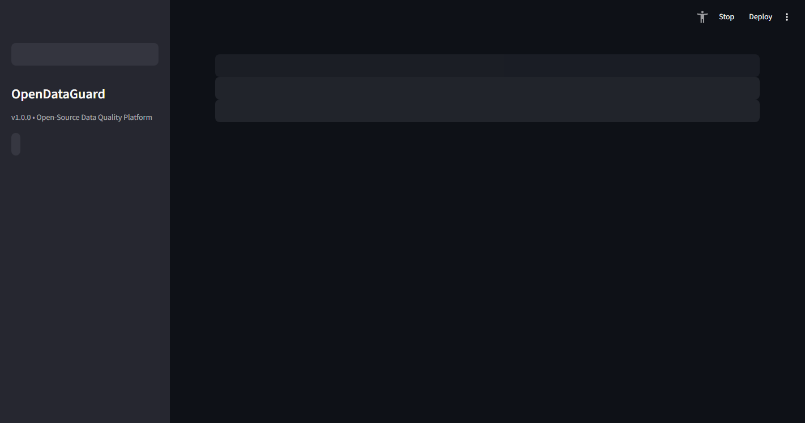
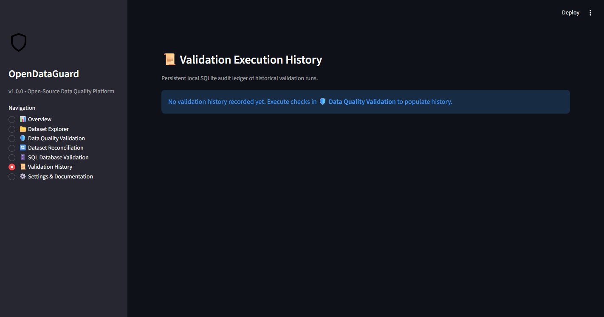

# OpenDataGuard Application Screenshots 📸

High-resolution visual previews of the **OpenDataGuard** platform captured directly from live application execution with synthetic demonstration datasets.

---

## Showcase Gallery

### 1. Overview Dashboard
*Visual summary of total audited runs, continuous Data Quality Scores, platform capabilities, and historical score trend charts.*


---

### 2. Dataset Explorer & Profiling
*Metadata cards (Rows, Columns, Duplicate Rows, Memory, Empty Columns), raw data preview table, statistical summary expander (`df.describe`), and missingness distribution bar chart.*


---

### 3. Data Quality Validation
*Interactive rule configuration, declarative YAML/JSON execution, continuous Data Quality Score gauge, and failing record sample drilldown table.*


---

### 4. Two-Way Dataset Reconciliation
*Source vs target 1-to-1 key diffing, tolerance configuration, match rate KPI, and breakdown of value mismatches, source-only, and target-only records.*


---

### 5. Read-Only SQL Database Validation
*Safe connection string parsing, table schema inspection, and bounded table sampling with credential sanitization.*


---

### 6. Local Validation History
*Persistent SQLite audit ledger, historical trend visualization, individual run details inspector, and audit purge controls.*


---

## Automated Screenshot Generation

To regenerate these screenshots automatically via Chrome DevTools Protocol:

```bash
# 1. Start Streamlit in headless mode
streamlit run app.py --server.port 8506 --server.headless true

# 2. In another terminal, run the capture script
python scripts/capture_screenshots.py
```
